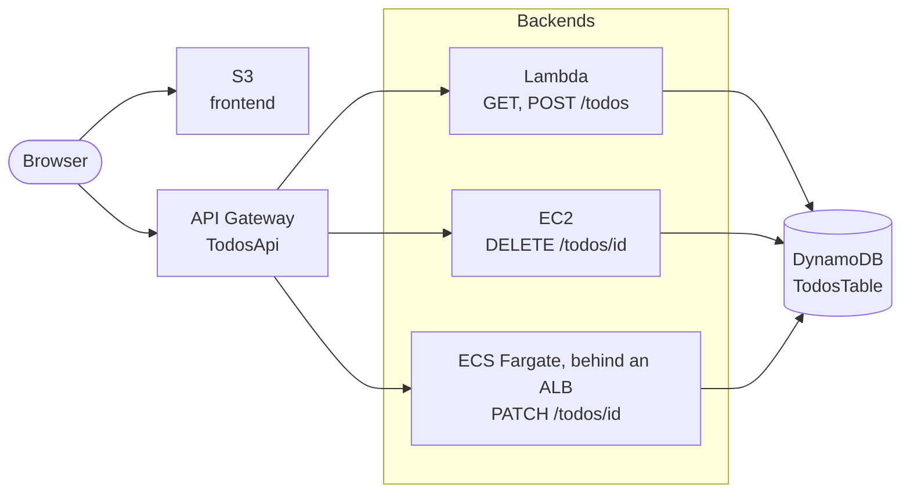
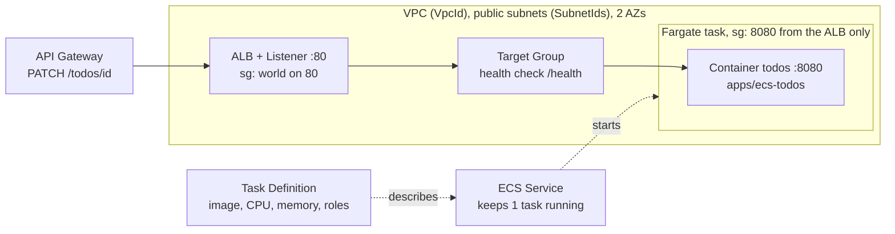
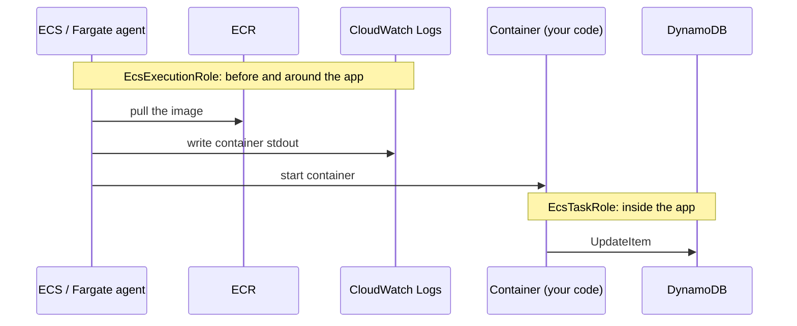
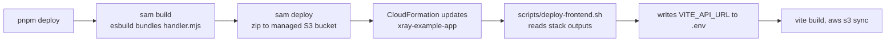

# Infrastructure

All resources live in one CloudFormation stack, `xray-example-app`, defined in `infrastructure/template.yaml`. Region `us-east-1`.

## Overview

## Resources

| Logical ID | Type | Purpose |
| --- | --- | --- |
| `FrontendBucket`, `FrontendBucketPolicy` | S3 bucket | Serves the built frontend. Public, HTTP only. |
| `TodosApi` | API Gateway REST API | The only API. `GET` and `POST /todos` go to the Lambda. `GET /` and `DELETE /todos/{id}` go to EC2. `PATCH /todos/{id}` goes to the ALB. Has CORS and tracing. |
| `TodosFunction` | Lambda | One handler for `GET` and `POST /todos`. |
| `TodosTable` | DynamoDB | Stores todos, key `id`. |
| `WebServerInstance`, `WebServerSecurityGroup` | EC2 + security group | Runs `apps/ec2` as the `todos-ec2` systemd service, with the X-Ray daemon. Port 80 open to the world, port 22 for `SshCidr`. |
| `WebServerEip`, `WebServerEipAssociation` | Elastic IP | A fixed address for the instance. The API integration URL uses it. |
| `WebServerRole`, `WebServerProfile` | IAM role | `AWSXRayDaemonWriteAccess`, `AmazonSSMManagedInstanceCore`, `DeleteItem` on the table, `GetObject` on the artifacts bucket. |
| `AppArtifactsBucket` | S3 bucket | Private. Holds `ec2-app.tgz`. |
| `EcsRepository` | ECR repository | Holds the `apps/ecs-todos` image. Emptied when the stack is deleted. |
| `EcsCluster`, `EcsService`, `EcsTaskDefinition` | ECS Fargate | One container (`todos`, port 8080, arm64). The app uses the X-Ray SDK. No daemon sidecar yet. The service starts with 0 tasks. `scripts/deploy-ecs.sh` sets it to 1. |
| `EcsAlb`, `EcsListener`, `EcsTargetGroup` | Application Load Balancer | The fixed address for the tasks. Health check on `/health`. |
| `EcsAlbSecurityGroup`, `EcsTaskSecurityGroup` | Security groups | ALB: port 80 from the world. Tasks: port 8080 from the ALB only. |
| `EcsExecutionRole`, `EcsTaskRole` | IAM roles | Execution: pull image, write logs. Task: `UpdateItem` on the table. No X-Ray policy yet. |
| `EcsLogGroup` | CloudWatch log group | Container logs, 7 days. |

## ECS in detail

Only the ECS part of the stack. The task role and the execution role are different identities with different jobs.

### Pieces and how a request reaches the container

### Who uses which role

| Role | Who assumes it | What it allows | Where it applies |
| --- | --- | --- | --- |
| `EcsExecutionRole` | ECS itself (the Fargate agent), not your code | Pull from ECR, write to CloudWatch Logs | Starting the task and shipping its logs. Your code never sees it. |
| `EcsTaskRole` | Your code, through the AWS SDK | `dynamodb:UpdateItem` on `TodosTable` | Calls made from inside the container. This is where `AWSXRayDaemonWriteAccess` goes later. |

Rule of thumb: the execution role gets the container running. The task role is what the app can do once it runs.

## One API Gateway

All routes live in the `DefinitionBody` of `TodosApi`.

- With an explicit `DefinitionBody`, SAM adds the CORS `OPTIONS` routes and the Lambda permissions. It does **not** add the integrations. Every route declares its own `x-amazon-apigateway-integration`.
- The EC2 routes point at the Elastic IP, not at the instance DNS name. A new instance keeps the same address, so the API deployment stays valid. SAM redoes the deployment only when the `DefinitionBody` text changes.
- `OpenApiVersion: 3.0.1` stops SAM from adding an extra `Stage` stage.

## What X-Ray shows

- **Todos path:** client, `TodosApi` stage, Lambda, DynamoDB. The Lambda is instrumented with `aws-xray-sdk-core`, so DynamoDB shows as a subsegment.
- **EC2 path:** the same `TodosApi` stage, then the EC2 node. API Gateway records a remote subsegment for the HTTP backend, and X-Ray infers a node from it (one per URL). The app on EC2 also sends its own segment through the daemon, and DynamoDB shows as a subsegment, because the role has `AWSXRayDaemonWriteAccess`. One node per URL: `/` and each `/todos/<id>` are separate inferred nodes. See `journal/0002-ec2-inferred-node-and-apps-layout.md`.

- **ECS path:** `PATCH /todos/{id}`. The app uses the X-Ray SDK, but the task has no daemon sidecar and the task role has no X-Ray policy. Expected: API Gateway segment and one inferred ALB node, nothing else, because the app's segments have nowhere to go. See `journal/0003-ecs-fargate-update.md`.

## Deploying the ECS app

`scripts/deploy-ecs.sh`, the last step of `pnpm deploy`. It logs in to ECR, builds `apps/ecs-todos` for arm64, pushes `:latest`, and sets the service to 1 task with a new deployment. Set `VpcId` and `SubnetIds` in `samconfig.toml` first (at least two subnets in different zones, with internet access, because tasks pull the image over a public IP).

## Deploying the EC2 app

Automatic, as the last step of `pnpm deploy` (`scripts/deploy-ec2.sh`).

1. The script packs `apps/ec2` (without `node_modules`) and uploads it to `AppArtifactsBucket` as `ec2-app.tgz`.
2. It restarts the `todos-ec2` service with SSM Run Command. No SSH is needed.
3. On every start, the service runs `/usr/local/bin/pull-app.sh`. It downloads the tarball, unpacks it to `/opt/todos-ec2`, and runs `npm install --omit=dev`.

A new instance installs Node, the X-Ray daemon, and the service from `UserData`. Until the first upload, the service retries every 15 seconds. `UserData` runs only on first boot, so a change to it needs a new logical ID for the instance.

Useful commands on the instance (`aws ec2-instance-connect ssh --instance-id <id>`): `systemctl status todos-ec2`, `journalctl -u todos-ec2`, `tail /var/log/xray/xray.log`.

## Deploy

`sam deploy` also uses a second stack, `aws-sam-cli-managed-default`. It holds only the S3 bucket for the Lambda zip. Do not delete it while you use SAM.
