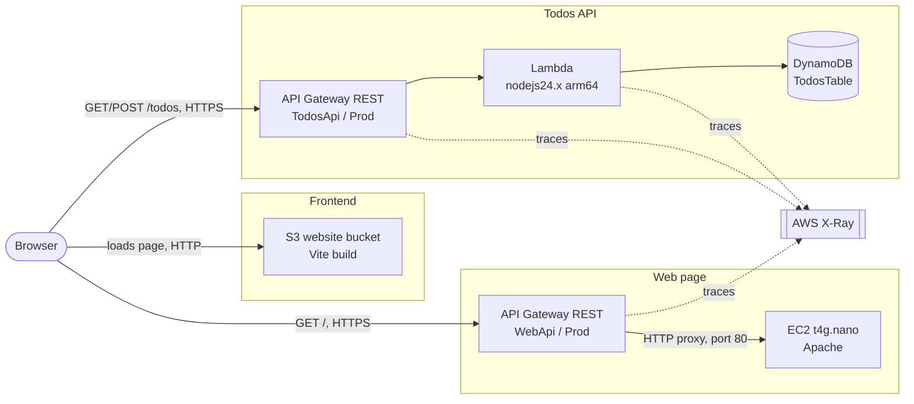
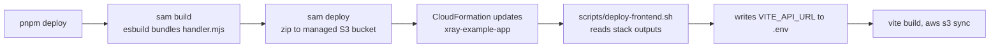

# Infrastructure

All resources live in one CloudFormation stack, `xray-example-app`, defined in `infrastructure/template.yaml`. Region `us-east-1`.

## Overview

## Resources

| Logical ID | Type | Purpose |
| --- | --- | --- |
| `FrontendBucket`, `FrontendBucketPolicy` | S3 bucket | Serves the built frontend. Public, HTTP only. |
| `TodosApi` | API Gateway REST API | Routes `GET` and `POST /todos` to the Lambda. Has CORS and tracing. |
| `TodosFunction` | Lambda | One handler for `GET` and `POST /todos`. |
| `TodosTable` | DynamoDB | Stores todos, key `id`. |
| `WebServerHost`, `WebServerSecurityGroup` | EC2 + security group | Apache serves one landing page. Port 80 open to the world. |
| `WebApi`, `WebRootMethod`, `WebDeployment`, `WebStage` | API Gateway REST API | Public URL for the EC2 page. Tracing on. |

## Why a second API Gateway

`WebApi` is separate from `TodosApi` on purpose:

- **Separate URL.** The EC2 page gets its own address.
- **Separate X-Ray node.** Each API shows as its own stage node in the service map.
- **Simple template.** `TodosApi` is generated by SAM from the Lambda events. Adding a raw HTTP-proxy route to it means mixing SAM and plain CloudFormation on one API, and the deployment does not pick up the change.
- **No extra cost.** API Gateway bills per request, not per API.

The alternative is one API with a `/ec2` route. It gives one URL and one node.

## What X-Ray shows

- **Todos path:** client, `TodosApi` stage, Lambda, DynamoDB. The Lambda is instrumented with `aws-xray-sdk-core`, so DynamoDB shows as a subsegment.
- **Web path:** client, `WebApi` stage, and an inferred EC2 node. Apache sends no traces. API Gateway records a remote subsegment for the HTTP backend, and X-Ray infers the node from it. See `journal/0002-inferred-node-discovery.md`.

## Deploying the EC2 app

By hand. SAM and `pnpm deploy` do not touch the instance.

1. Connect: `aws ec2-instance-connect ssh --instance-id <id>` (port 22 is open for `SshCidr` only).
2. Put `apps/ec2/package.json` and `apps/ec2/server.js` in `~/app`.
3. Run `npm install`.
4. Start it: `sudo TABLE_NAME=<TableName output> AWS_REGION=us-east-1 node server.js`. Port 80 needs root.

The instance has the X-Ray daemon installed by hand and an IAM role from the template. The app is not a service, so it stops when the SSH session ends.

## Deploy

`sam deploy` also uses a second stack, `aws-sam-cli-managed-default`. It holds only the S3 bucket for the Lambda zip. Do not delete it while you use SAM.
