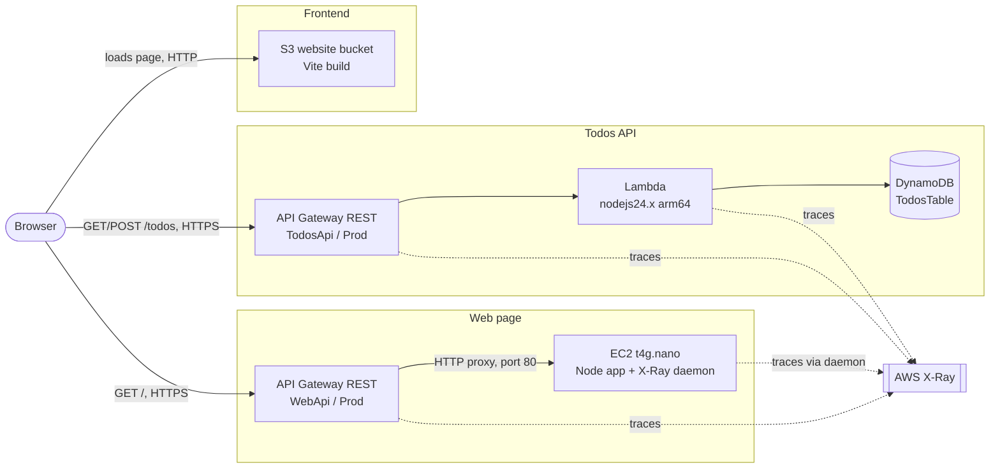
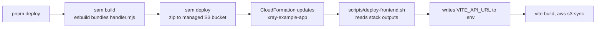

# Infrastructure

All resources live in one CloudFormation stack, `xray-example-app`, defined in `infrastructure/template.yaml`. Region `us-east-1`.

## Overview

## Resources

| Logical ID | Type | Purpose |
| --- | --- | --- |
| `FrontendBucket`, `FrontendBucketPolicy` | S3 bucket | Serves the built frontend. Public, HTTP only. |
| `TodosApi` | API Gateway REST API | Routes `GET` and `POST /todos` to the Lambda. Has CORS and tracing. |
| `TodosFunction` | Lambda | One handler for `GET` and `POST /todos`. |
| `TodosTable` | DynamoDB | Stores todos, key `id`. |
| `WebServerInstance`, `WebServerSecurityGroup` | EC2 + security group | Runs `apps/ec2` as the `todos-ec2` systemd service, with the X-Ray daemon. Port 80 open to the world, port 22 for `SshCidr`. |
| `WebServerRole`, `WebServerProfile` | IAM role | `AWSXRayDaemonWriteAccess`, `AmazonSSMManagedInstanceCore`, `DeleteItem` on the table, `GetObject` on the artifacts bucket. |
| `AppArtifactsBucket` | S3 bucket | Private. Holds `ec2-app.tgz`. |
| `WebApi`, `WebRootMethod`, `WebDeployment`, `WebStage` | API Gateway REST API | Public URL for the EC2 page. Tracing on. |

## Why a second API Gateway

`WebApi` is separate from `TodosApi` on purpose:

- **Separate URL.** The EC2 page gets its own address.
- **Separate X-Ray node.** Each API shows as its own stage node in the service map.
- **Simple template.** `TodosApi` is generated by SAM from the Lambda events. Adding a raw HTTP-proxy route to it means mixing SAM and plain CloudFormation on one API, and the deployment does not pick up the change.
- **No extra cost.** API Gateway bills per request, not per API.

The alternative is one API with a `/ec2` route. It gives one URL and one node.

## What X-Ray shows

- **Todos path:** client, `TodosApi` stage, Lambda, DynamoDB. The Lambda is instrumented with `aws-xray-sdk-core`, so DynamoDB shows as a subsegment.
- **Web path:** client, `WebApi` stage, and the EC2 node. API Gateway records a remote subsegment for the HTTP backend, and X-Ray infers a node from it (one per URL). The app on EC2 also sends its own segment through the daemon, and DynamoDB shows as a subsegment, because the role has `AWSXRayDaemonWriteAccess`. See `journal/0002-ec2-inferred-node-and-apps-layout.md`.

## Deploying the EC2 app

Automatic, as the last step of `pnpm deploy` (`scripts/deploy-ec2.sh`).

1. The script packs `apps/ec2` (without `node_modules`) and uploads it to `AppArtifactsBucket` as `ec2-app.tgz`.
2. It restarts the `todos-ec2` service with SSM Run Command. No SSH is needed.
3. On every start, the service runs `/usr/local/bin/pull-app.sh`. It downloads the tarball, unpacks it to `/opt/todos-ec2`, and runs `npm install --omit=dev`.

A new instance installs Node, the X-Ray daemon, and the service from `UserData`. Until the first upload, the service retries every 15 seconds. `UserData` runs only on first boot, so a change to it needs a new logical ID for the instance.

Useful commands on the instance (`aws ec2-instance-connect ssh --instance-id <id>`): `systemctl status todos-ec2`, `journalctl -u todos-ec2`, `tail /var/log/xray/xray.log`.

## Deploy

`sam deploy` also uses a second stack, `aws-sam-cli-managed-default`. It holds only the S3 bucket for the Lambda zip. Do not delete it while you use SAM.
