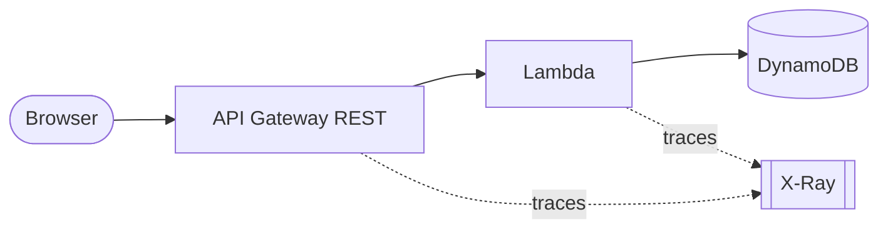

# Journal 01: First configuration, deploy and CORS
* **Date:** 2026-10-23
* **Main goal:** Deploy a todo app (API Gateway, Lambda, DynamoDB, S3 frontend) with X-Ray tracing, using SAM.

---

## 1. Segment: Base stack
* **Action:** Built one SAM template: DynamoDB table, REST API with tracing, one Lambda (`GET` and `POST /todos`) with `aws-xray-sdk-core` around the DynamoDB client, and a Vite frontend.
* **Result:** ✅ *Worked*. The stack deploys and the API answers.
* **Finding / Technical note:** SAM deploys the stack only. It does not upload the frontend. A second step is needed.

## 2. Segment: Template in `infrastructure/`
* **Action:** Moved `template.yaml` to `infrastructure/template.yaml`. Updated `CodeUri`, the `sam build` script (`-t`), and the docs.
* **Result:** ✅ *Worked*.
* **Finding / Technical note:** `CodeUri` is relative to the template file, so it became `../packages/backend`.

## 3. Segment: Node version and SAM build
* **Action:** Moved Node from 22 to the newest. Tried `nodejs26.x` for the Lambda. Fixed `Cannot find esbuild` in `sam build`.
* **Result:** ⚠️ *With warnings*. Node 24 and `nodejs24.x` work. `nodejs26.x` is a Lambda preview runtime and SAM CLI `1.169.0` rejects it (`'nodejs26.x' runtime is not supported`).
* **Finding / Technical note:** SAM builds in a temp folder and cannot see the pnpm bin. Adding `"npm:esbuild"` to `mise.toml` puts `esbuild` on `PATH`. A newer SAM CLI release was hidden by mise's `minimum_release_age`.

## 4. Segment: First deploy
* **Action:** Ran `sam deploy --guided`. Then switched to `sam deploy`, which reads `samconfig.toml`.
* **Result:** ⚠️ *With warnings*. Two failed attempts before it worked.
* **Finding / Technical note:** Stack names allow only letters, digits, and hyphens. An underscore failed, and so did a trailing space. `--guided` is only for the first run. SAM also makes a second stack, `aws-sam-cli-managed-default`, for its upload bucket. Keep it.

## 5. Segment: Two stages in API Gateway
* **Action:** Saw both `Prod` and `Stage`. Added an explicit `AWS::Serverless::Api` with `OpenApiVersion`.
* **Result:** ✅ *Worked*. New deploys make only `Prod`. The old `Stage` was deleted by hand.
* **Finding / Technical note:** CloudFormation deletes only what it owns. `Stage` was a side effect of the deployment resource, so it was never tracked and stayed after the fix.

## 6. Segment: 502 from the Lambda
* **Action:** Read the Lambda logs for the failed calls.
* **Result:** ✅ *Worked*. Fixed with esbuild `OutExtension: .js=.mjs`.
* **Finding / Technical note:** Error `Cannot use import statement outside a module`. The ESM bundle was named `.js` and the Lambda package had no `"type": "module"`. A `.mjs` file is always read as ESM. Command: `aws logs tail /aws/lambda/<function> --since 30m`.

## 7. Segment: CORS
* **Action:** Added `Cors` to `TodosApi`.
* **Result:** ✅ *Worked*. `OPTIONS` returns `200` with the CORS headers.
* **Finding / Technical note:** The browser sends an `OPTIONS` preflight before a `POST` with JSON. With no `OPTIONS` route, API Gateway answers `403`. With a Lambda proxy, the handler must still return `Access-Control-Allow-Origin` itself.

## 8. Segment: Frontend on S3
* **Action:** Added a public S3 bucket with website hosting and `scripts/deploy-frontend.sh`. The script reads the stack outputs, writes `VITE_API_URL` into `.env`, builds, and uploads.
* **Result:** ✅ *Worked*.
* **Finding / Technical note:** `undefined/todos` means `VITE_API_URL` was empty at build time. Vite bakes it into the code. The S3 website is HTTP only.

---

## 📌 Summary and Next Steps
* **Key achievements:** Full stack deployed. One `pnpm deploy` builds, deploys, and uploads the frontend. X-Ray traces the API and the Lambda.
* **Technical debt or pending items for tomorrow:** `nodejs26.x` waits for SAM CLI support. The S3 site has no HTTPS.
