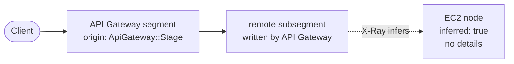

# Journal 02: EC2 in X-Ray and the apps layout
* **Date:** 2026-10-25
* **Main goal:** Add an EC2 web server behind a second API Gateway, see how it looks in X-Ray, and organize the repo.

---

## 1. Segment: EC2 web server behind a second API Gateway
* **Action:** Added an EC2 `t4g.nano` with Apache, a security group, and a separate REST API (`WebApi`) with an HTTP proxy to the instance. Added `architecture/infrastructure.md`.
* **Result:** ⚠️ *With warnings*. It worked after one fix.
* **Finding / Technical note:** API Gateway returned `network error communicating with endpoint`. The console log showed `dnf` killed by the OOM killer: 0.5 GB of RAM is too little to install Apache. Fix: a 1 GB swap file in `UserData`. `UserData` runs only on first boot, so the logical ID was renamed (`WebServerHost`) to force a new instance. A raw `AWS::ApiGateway::Deployment` does not redeploy when methods change, so rename it (`WebDeploymentV2`) when routes change.

## 2. Segment: Why EC2 shows in the X-Ray map
* **Action:** Read the raw trace (`get-trace` JSON) of a call to the Apache page.
* **Result:** ✅ *Worked*. Confirmed the node is inferred.
* **Finding / Technical note:** API Gateway writes a `remote` subsegment named after the EC2 URL. X-Ray then generates a segment with `inferred: true` whose `parent_id` is that subsegment. Nothing on EC2 sent it, so it has no details.

Rule: a caller records "I called X". X-Ray draws X as an inferred node. X draws itself only when it sends its own segments.

## 3. Segment: SSH and the X-Ray daemon
* **Action:** Opened port 22 in the security group for one IP (parameter `SshCidr`, set in `samconfig.toml`). Connected with EC2 Instance Connect. Installed the X-Ray daemon by hand from the arm64 RPM.
* **Result:** ✅ *Worked*. The daemon runs and listens on `127.0.0.1:2000`.
* **Finding / Technical note:** The daemon logs to `/var/log/xray/xray.log`, not to `journalctl`. The `SshCidr` parameter keeps the home IP out of git. The IP is the source allowed in, not the instance IP. The daemon alone sends nothing. An app with the X-Ray SDK makes the segments, and an IAM role with `AWSXRayDaemonWriteAccess` lets the daemon send them.

## 4. Segment: Apps layout and the pnpm catalog
* **Action:** Moved every app into `apps/` (`lambda-todos`, `ec2`, `frontend`). Added a pnpm `catalog:` in `pnpm-workspace.yaml`. Added repo rules in `.claude/rules/`.
* **Result:** ⚠️ *With warnings*. Only the frontend uses `catalog:`.
* **Finding / Technical note:** `sam build` failed with `EUNSUPPORTEDPROTOCOL`. SAM's esbuild build runs `npm install`, and npm cannot read `catalog:`. Options: keep explicit versions in Lambdas, or use `BuildMethod: makefile` so pnpm works. Decision: explicit versions, no Makefile, because the focus of the project is X-Ray. `apps/ec2` also keeps explicit versions, because npm installs it on the instance.

## 5. Segment: `DELETE /todos/:id` on EC2
* **Action:** Wrote `apps/ec2` (Express with the X-Ray SDK and DynamoDB). Added an IAM role with `dynamodb:DeleteItem` only, a `WebApi` route `ANY /todos/{id}`, and a Delete button in the frontend.
* **Result:** ✅ *Worked*. After `pnpm deploy`, Node on the instance, and the app copied over, the Delete button removes the todo through the second API Gateway.
* **Finding / Technical note:** The X-Ray policy is left out on purpose, to see the failure first. The app is deployed by hand over SSH and stops when the session ends. To copy files: push a public key with `aws ec2-instance-connect send-ssh-public-key` (valid 60 seconds, the key must be passed as `file://<path>`), then use plain `scp -i <key>`. Node comes from `dnf` (`dnf list available 'nodejs*'`). Apache must be stopped (`sudo systemctl disable --now httpd`) to free port 80.

## 6. Segment: Reading the service map
* **Action:** Looked at the X-Ray service map after a few calls and listed its nodes with `aws xray get-service-graph`.
* **Result:** ✅ *Worked*. The three EC2 nodes are not three instances. Only one instance exists.
* **Finding / Technical note:** API Gateway names each `remote` subsegment with the full URL, and X-Ray makes one inferred node per name. So `/`, `/todos/<id>`, and `/todos/test` are three nodes for the same host. Each todo deleted adds a node. The todos path (API Gateway, Lambda, DynamoDB) is complete because the Lambda sends its own segments. The EC2 side stays inferred until the X-Ray policy is added.

## 7. Segment: Docs site with Docusaurus
* **Action:** Asked a subagent to create `apps/docs`, a Docusaurus site that reads `architecture/decisions/` and `architecture/journal/` in place, with Mermaid enabled and no other content.
* **Result:** ⚠️ *With warnings*. `pnpm --filter docs build` passes with no warnings and no broken links. The site was not opened in a browser yet, so the Mermaid diagrams are not seen with eyes.
* **Finding / Technical note:** One source of truth: the site points at the existing markdown folders (`path: '../../architecture'`) instead of copying them, and `infrastructure.md` is excluded. Three build problems on the way: `"type": "module"` in `package.json` broke the build (`require.resolveWeak is not a function`), Mermaid needs `@mermaid-js/layout-elk`, and with docs at `/` the navbar link was broken until an intro page was added. Mermaid renders in the browser only, so the diagram source is in a JS chunk, not in the static HTML. Run it with `pnpm dev:docs`.

## 8. Segment: Automating the EC2 setup
* **Action:** Moved the manual steps into the template and scripts. The instance role got `AWSXRayDaemonWriteAccess` and `AmazonSSMManagedInstanceCore`. `UserData` installs Node, the X-Ray daemon, and a systemd service `todos-ec2`. A private bucket `AppArtifactsBucket` holds `ec2-app.tgz`. New `scripts/deploy-ec2.sh` packs `apps/ec2`, uploads it, and restarts the service. `pnpm deploy` now runs it last.
* **Result:** ⚠️ *With warnings*. Written and `sam validate --lint` passes. Not deployed yet, so nothing here is proven on a real instance.
* **Finding / Technical note:** The service pulls the tarball from S3 on every start (`ExecStartPre`), so a first boot before the first upload just retries every 15 seconds. Restart goes through SSM Run Command, so SSH is not needed for deploys. Changing `UserData` needs a new logical ID (`WebServerInstance`), and the raw API Gateway deployment needs a new one too (`WebDeploymentV3`), because the instance URL changes. Apache is gone: the Node app serves `/` as well. `tmux` is installed for SSH sessions.

## 9. Segment: Docs site on GitHub Pages
* **Action:** Asked a second subagent for a GitHub Actions workflow, `.github/workflows/docs.yml`. On every push to `main` (and by hand) it builds `apps/docs` and deploys it to GitHub Pages. The Docusaurus config got `url`, `baseUrl: '/aws-xray-example/'`, `organizationName`, `projectName`, and `trailingSlash: false`.
* **Result:** ⚠️ *With warnings*. The build passes locally with the new `baseUrl`, and `pnpm install --frozen-lockfile` passes. The workflow has not run on GitHub, because it triggers only on `main` and this branch is not merged.
* **Finding / Technical note:** A project page is served under `/<repo>/`, so `baseUrl` must match or every asset path breaks. The workflow uses the official Pages flow (`upload-pages-artifact`, then `deploy-pages`) with `pages: write` and `id-token: write`. `pnpm/action-setup` reads the pnpm version from the root `packageManager` field. One manual step: Settings, Pages, Source = GitHub Actions.

---

## 📌 Summary and Next Steps
* **Key achievements:** EC2 appears in the map as an inferred node, and the cause is understood. SSH and the daemon work. `DELETE /todos/:id` works on EC2. The repo has a clear layout and written rules.
* **Technical debt or pending items for tomorrow:**
  * Run `pnpm deploy` and check that the new instance serves the app and sends segments (`tail /var/log/xray/xray.log`). Look for the real EC2 node and the DynamoDB subsegment in X-Ray.
  * Find the one fault on the `xray-example-web/Prod` node (`fault = true`).
  * Open the docs site with `pnpm dev:docs` and check the Mermaid diagrams.
  * Set Pages to GitHub Actions in the repo settings, merge to `main`, and check that the workflow publishes the site.
  * Automate the EC2 app deploy (`UserData` or S3).
