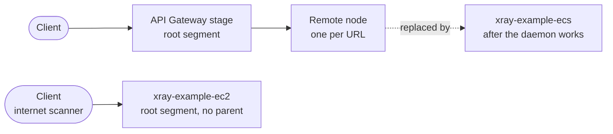
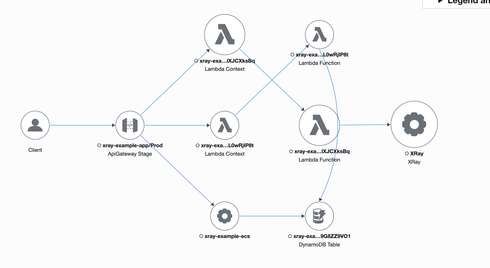

# Journal 03: ECS Fargate and the Update feature
* **Date:** 2026-10-26
* **Main goal:** Run a container on ECS Fargate that serves `PATCH /todos/:id`, with no X-Ray set up, to see how it fails and then fix it step by step.

---

## 1. Segment: Fargate over reusing the EC2 instance
* **Action:** Compared two ways to run ECS: Fargate, or the existing EC2 instance as ECS capacity.
* **Result:** ✅ *Worked*. Chose Fargate with an ALB (Application Load Balancer) in front.
* **Finding / Technical note:** Reusing the instance needs the ECS agent and a new image, and its `UserData` already runs another app. A Fargate task gets a new IP on every deploy, so API Gateway needs a fixed address: the ALB. A Cloud Map plus VPC Link setup is cheaper but was left out.

## 2. Segment: The ECS app and its infrastructure
* **Action:** Wrote `apps/ecs-todos` (Express, `PATCH /todos/:id`, `Dockerfile`), `scripts/deploy-ecs.sh`, and in `infrastructure/template.yaml` the ECR repo, cluster, task definition, service, ALB, security groups, roles, and a `patch` route in `TodosApi`. Added a Done/Undo button to the frontend.
* **Result:** ⚠️ *With warnings*. `sam validate --lint` passes. Not deployed and not verified.
* **Finding / Technical note:** The service starts with `DesiredCount: 0`, because ECR is empty on the first deploy and the stack would wait for a task that cannot start. `deploy-ecs.sh` pushes the image and sets 1. `UpdateItem` creates a missing item, so the app adds `attribute_exists(id)` and returns 404 instead.

## 3. Segment: X-Ray in the code, not in the infrastructure
* **Action:** The app uses `aws-xray-sdk-core` and `aws-xray-sdk-express` (`openSegment`, `closeSegment`) and wraps the DynamoDB client with `captureAWSv3Client`. The task has one container, no `aws-xray-daemon` sidecar. `EcsTaskRole` has no X-Ray policy.
* **Result:** ✅ *Worked as a test*. The trace is broken in the expected way (see segment 6).
* **Finding / Technical note:** The SDK sends segments to a daemon on `127.0.0.1:2000`. Nothing listens there, so the segments are dropped. Expected in X-Ray: the API Gateway segment and an inferred ALB node, with no details and no DynamoDB subsegment. Fix list, one at a time: (1) add the daemon sidecar, (2) add `AWSXRayDaemonWriteAccess` to the task role, (3) set `AWS_XRAY_DAEMON_ADDRESS` to the sidecar if it does not share `127.0.0.1`.

## 4. Segment: First deploy and the empty service
* **Action:** Ran `pnpm deploy` with the new VPC parameters.
* **Result:** ⚠️ *With warnings*. Three separate problems, fixed one by one.
* **Finding / Technical note:**
  * The first deploy ran with `CHANGE_ME` in `VpcId` and `SubnetIds`. CloudFormation rolled back and left the stack in `ROLLBACK_COMPLETE`, which cannot be updated. Delete the stack, then deploy again. No resource was created, so nothing was lost.
  * `SubnetIds` had one subnet. An ALB needs at least two, in different AZs.
  * The service stayed at `desiredCount: 0` and ECR was empty, because Docker was not running and `deploy-ecs.sh` stopped at the first `docker` command. Checks that found it: `aws ecr describe-images`, `aws ecs describe-services`, `aws ecs list-tasks --desired-status STOPPED`.
  * While the service had no task, `PATCH` returned `503` from the ALB. That page has no CORS headers, so the browser only showed `Failed to fetch`.

## 5. Segment: Inline title edit in the frontend
* **Action:** Click on the todo text turns it into an input. Enter sends `PATCH /todos/:id` with `{ title }`. Escape or leaving the field cancels.
* **Result:** ✅ *Worked*.
* **Finding / Technical note:** The backend already took `title`. Only the frontend lacked the edit. The first "edit is broken" report was the `503` above, not the edit code.

## 6. Segment: Reading the service map and the traces
* **Action:** Checked the map with `aws xray get-service-graph`, `get-trace-summaries` and `batch-get-traces`.
* **Result:** ✅ *Worked*. Every oddity on the map has a reason.
* **Finding / Technical note:**
  * **Two Lambda nodes:** Lambda writes two segments. `AWS::Lambda` is the service. `AWS::Lambda::Function` is the code, and it is the child.
  * **Many Remote nodes:** API Gateway names the remote node with the full URL, so each `/todos/<id>` on the ALB is its own node. Failed calls (`503`) make them too. No segment comes from ECS, because the SDK sends to `127.0.0.1:2000` and no daemon listens there.
  * **The ALB cannot fix it.** It only adds the `X-Amzn-Trace-Id` header. It sends no segments to X-Ray. A real segment from the container replaces the Remote nodes, as `xray-example-ec2` already does for `DELETE /todos/<id>`.
  * **Second Client node:** internet scanners (`zgrab` user agent, non-AWS IPs) call the EC2 Elastic IP directly. The EC2 app has the SDK, so each call is a root segment with no parent, and X-Ray draws a Client for it.

## 7. Segment: Finding, restrict the backends to API Gateway
* **Action:** Discussed how to make the ALB, and the EC2, accept only calls from API Gateway. Nothing was changed.
* **Result:** ⚠️ *Left open on purpose*. Both stay reachable by anyone who knows the address.
* **Finding / Technical note:** A REST API has no fixed IP and no security group, so a security group rule cannot say "only API Gateway". Two options. (A) API Gateway adds a secret header, and an ALB listener rule forwards only when it matches, with a fixed `403` otherwise. It is a shared secret. (B) An internal ALB behind a VPC Link, so there is no public address. It is stronger, but the classic REST VPC Link needs an NLB, so check what REST supports today. For the EC2 app, the same header can be checked in `server.js`.
* **Related:** when the daemon works, the ALB health check (`/health`, every 15 seconds, per container) becomes a trace with its own Client node. Declare the `/health` route before `openSegment` in `apps/ecs-todos/server.js`.

## 8. Segment: Daemon sidecar, without the IAM policy
* **Action:** Added a second container, `xray-daemon` (`public.ecr.aws/xray/aws-xray-daemon:latest`, command `-o`, UDP 2000, `Essential: false`), to `EcsTaskDefinition`. Moved `GET /health` before `openSegment` in `apps/ecs-todos/server.js`. `EcsTaskRole` still has no X-Ray policy.
* **Result:** ✅ *Worked*. The sidecar starts and receives segments.
* **Finding / Technical note:** With `awsvpc` networking, all containers in a task share one network, so the app reaches the daemon on `127.0.0.1:2000` and `AWS_XRAY_DAEMON_ADDRESS` is not needed. `-o` (local mode) skips the EC2 metadata call, which does not exist on Fargate. Expected next: the SDK sends, the daemon receives, and the daemon logs `AccessDenied` for `xray:PutTraceSegments` in the `xray-daemon` log stream. The map does not change until the policy is added.

---

## 9. Segment: AccessDenied, then the X-Ray policy
* **Action:** Deployed the sidecar. Read the `xray-daemon` log stream. Then added `AWSXRayDaemonWriteAccess` to `EcsTaskRole`.
* **Result:** ✅ *Worked*. After the deploy, a new task logged `Successfully sent batch of 1 segments` and the `403` stopped.
* **Finding / Technical note:** The daemon logged `Sending segment batch failed ... 403 ... AccessDeniedException: User: ...assumed-role/...EcsTaskRole... is not authorized to perform: xray:PutTraceSegments`. Only the daemon shows the error. The app sends UDP and never waits for an answer. The daemon uses the task role, so one managed policy on `EcsTaskRole` is the fix. The daemon also logs a warning that its proxy is bound to `0.0.0.0:2000`. The task security group only opens port 8080 and only to the ALB, so the port is not reachable from outside. To remove the warning, bind it to `127.0.0.1:2000`. A task has one task role, so a separate role for the daemon is not possible inside the same task.

---

## 10. Segment: Trace viewer (Lambda + a second frontend page)
* **Action:** Wrote `apps/lambda-traces` (`GET /traces/services`, `GET /traces`) with `TracesFunction` and two routes in `TodosApi`. Added `traces.html` and `src/traces.ts` to the frontend, with a `vite.config.ts` for two pages. Left sidebar: the service graph nodes. Right: the newest 10 traces of the selected node, each segment with an accordion of subsegments.
* **Result:** ✅ *Worked*. Typecheck, `vite build` and `sam validate --lint` pass. Deployed and working in the browser.
* **Finding / Technical note:** A node is a `(name, type)` pair, so the filter is `service(id(name: "...", type: "..."))`. A segment with no origin has no type. The DynamoDB node is named after the table, but its segment is named `DynamoDB`, so the match also reads `aws.table_name`. An inferred `remote` node has no segment, so the function returns the caller's subsegment. `BatchGetTraces` takes 5 ids per call, so the ids go in chunks. The function wraps its own X-Ray client, so its reads show up in the service map.

---

## 11. Segment: What each ECS resource does
* **Action:** Went through every ECS resource in the template, one by one, and corrected the mental model.
* **Result:** ✅ *Worked*. Learning notes, no code.
* **Finding / Technical note:**
  * **`EcsRepository`** (ECR): stores the image.
  * **`EcsTaskDefinition`**: a recipe, not a creator. It holds image, CPU, memory, port, env vars, log config and both roles. A task is one running copy.
  * **`EcsService`**: keeps N tasks alive and registers their IPs in the target group. It is an ECS concept, not a Fargate one. Fargate only means no servers to manage. A one-off job is a standalone task, without a service.
  * **`EcsCluster`**: a logical group of services. It is not in the request path.
  * **`EcsAlb` + `EcsListener`**: the listener lives inside the ALB: port 80 plus a rule, "forward to the target group". Without it the ALB accepts nothing.
  * **`EcsTargetGroup`**: the list of container IPs, with the health check (`/health`). It does no autoscaling. The count is `DesiredCount` on the service.
  * **Security groups**: allow rules only, stateful. The ALB one allows port 80 from anywhere. The task one allows 8080 from the ALB group only.
  * **`EcsExecutionRole`**: used by ECS itself to pull the image and write logs. **`EcsTaskRole`**: used by the code and the daemon inside the task. A task has one task role.
  * **VPC and subnets**: each task gets a network card (ENI) with an IP from a subnet, which also decides the AZ and the routes. The ALB needs two subnets in two AZs. Without a NAT gateway, tasks need public subnets and `AssignPublicIp: ENABLED` to pull from ECR.
  * **Sidecar network**: containers in one task share the network (`awsvpc`), so the app reaches the daemon on `127.0.0.1:2000`, the SDK default.

## 12. Segment: Docs cleanup
* **Action:** Rewrote the overview diagram in `architecture/infrastructure.md` (no X-Ray box, no trace arrows, four columns). Added the `ECS in detail` section: a pieces diagram, a role sequence diagram and a role table.
* **Result:** ⚠️ *With warnings*. Written, not checked in the rendered site.
* **Finding / Technical note:** X-Ray is in every component, so drawing it as a box with arrows only added lines. The service map is the place for it.

## 13. Segment: Final service map
* **Action:** Read the service map after the daemon and the policy were in place, and saved it as `architecture/journal/img/service-map-final.png`.
* **Result:** ✅ *Worked*. This is the target output of the day.
* **Finding / Technical note:** The ECS path is now one real node, `xray-example-ecs`, with an arrow to DynamoDB. The Remote nodes are gone. There are two Lambda pairs: the todos function and the traces function. Each pair is `AWS::Lambda` (the service) and `AWS::Lambda::Function` (the code). The traces function has an arrow to an `XRay` node, because its X-Ray client is wrapped. The EC2 node and the scanner Client are missing only because nothing called the EC2 in this time range.

---

## 📌 Summary and Next Steps
* **Key achievements:** ECS Fargate path working end to end. First a broken trace on purpose, then fixed in steps: SDK, daemon sidecar, IAM policy. Trace viewer page. Title edit and Done in the frontend.
* **Technical debt or pending items for tomorrow:** Decide on the header or VPC Link restriction (segment 7). Bind the daemon to `127.0.0.1:2000` (segment 9). The EC2 app is still open to the internet, so scanners reach it.
